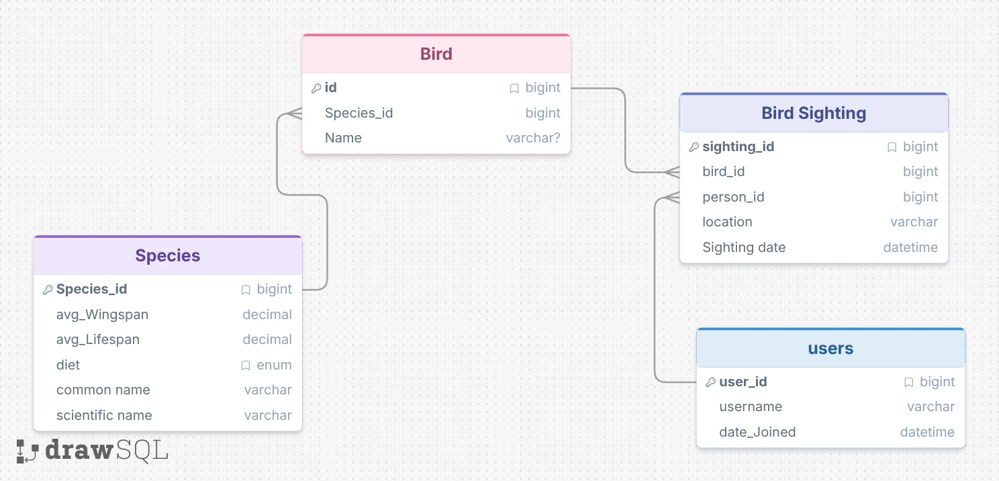

# Note
most of this was pulled from professor Reynolds project. I just took it and plugged in my own database, questions, and example prompts



This database I created has a bit of fake data about birds and birdwatching. We store various birds and users and also what birds were seen by who and different species info for each bird. This could be the foundation for a simple bird watching/tracking app. 


Some questions that worked were "Who has seen the most individual birds" and "Who has been a user the longest". A question that had issues was "What was the common name of the last bird seen by Sydney_sky_spotter" This should be possible however it was a much more complex question. I would be interested to see if others had luck with complex questions. Also it struggled with ties as it would only ask with limit 1 and therefore couldn't inform us about ties


It also struggled with what bird has the largest avg wingspan. It got the right data from the SQL but then used its general knowledge and said the wandering albatross.  So it was struggling with the task there. If I added to the prompt to respond from the knowledge returned it did work.


I didn't notice much between the multi and single prompt patterns but the single did better that the zeroshot on several questions. Also the Multi prompt one liked to say done at the end of it's prompts.


# Example AI SQL Database

## Description
This example represents the mock data to manage an upcoming dogshow. 

## Overview of the Files
* **db_bot.py**: This is the main script that initializes the database, manages the prompting strategies and sends the questions to OpenAI.
* **setup.sql**: Contains the information to setup the tables and structure of the database.
* **setupData.sql**: Contains the mock information that fills the tables in the database.
* **config.json**: Contains the OpenAI API Key. **Note: Don't share or commit yours.**
* **responses_\<strategy>_\<time>.json**: The output logs that record the provided prompts and questions, as well as the generated SQL queries and natural language responses.

## Running the example

From this directory, install the Python dependency before running the script:

```powershell
python -m pip install -r requirements.txt
python db_bot.py
```

The script reads the API key from `config.json`. Do not commit or share a real API key.

## Prompting Strategies Used
This project attempts to try out the three strategies “zero-shot, single-domain, and cross-domain” as outlined in this paper: https://arxiv.org/abs/2305.11853 <- read it 😊
